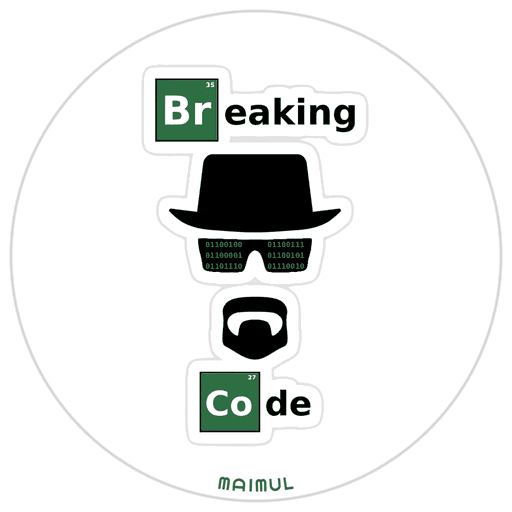

  

  <b>Cloud & Infrastructure Engineer | Solutions Architect | Technical Lead | Founder, Teh C Labs</b>
   
  Designing cloud-native platforms, integrating complex systems, and turning business requirements into production-ready solutions.

  
  
  
  

---

### 👨‍💻 About Me

I'm a Cloud & Infrastructure Engineer working at the intersection of **solution architecture, platform engineering, and software delivery**.

My work goes beyond infrastructure: I partner with stakeholders to refine requirements, design architectures and workflows, integrate backend services, and lead delivery from design through demo and deployment.

I care most about building systems that are reliable, observable, secure, and practical to operate.

- 🏗️ **Solution Architecture:** Requirements engineering, system design, integrations, and technical decision-making.
- ☁️ **Cloud & Platform Engineering:** Kubernetes, OpenShift, cloud infrastructure, networking, and hybrid environments.
- ⚙️ **DevOps & Automation:** Infrastructure as Code, GitOps, CI/CD, secrets management, and deployment automation.
- 📊 **Observability & Reliability:** Metrics, logs, distributed tracing, and performance optimization.
- 🤖 **AI & Intelligent Systems:** AI-powered software engineering, agents, and enterprise integrations.
- 🚀 **Product Building:** Founder of Teh C Labs, a software design studio building vertical SaaS products.

### 🧪 Teh C Labs

> *Crafted around the people who use it.*

I run **[Teh C Labs](https://tehclabs.my)** ([@TehCLabs](https://github.com/TehCLabs)), a software design studio. The goal is not to be first, but to be the first to design it properly. Current products:

| Product | What it is | Status |
| --- | --- | --- |
| 🏢 **CondoOS** | Multi-tenant condo management platform. Buildings still run on outdated software, WhatsApp threads and manual work; CondoOS gives management offices and committees real visibility. FastAPI backend, Expo / React Native app, and an AI committee assistant built on MCP with human-in-the-loop guardrails. | Active development |
| 💈 **BarberOS** | Shop management for barbershops, built on reusable components from CondoOS with a clean, solid architecture. | Active development |

### 🔬 Currently Exploring

- **Agent protocols:** MCP, A2UI, AG-UI and A2A for safe, multi-tenant AI assistants
- **ARM & edge:** on-prem deployments on ARM hardware and self-hosting on single-board computers
- **Multi-arch delivery:** building ARM + x86 container images with native GitHub Actions ARM runners
- **Compliance-aware SaaS:** modelling real-world regulations (strata management, e-invoicing) directly into product design

### 📰 Today I Learned

Real problems from real work, written up like newspaper features on [my blog](https://maimul.github.io/blog/).

<!-- BLOG-POST-LIST:START -->
- [The Deploy That Went Green and Shipped Nothing](https://maimul.github.io/blog/005-deploy-green-shipped-nothing/) · Oct 26, 2026
- [The Guard That Couldn’t Read, So It Waved the Commit Through](https://maimul.github.io/blog/004-green-gate-red-commit/) · Oct 24, 2026
- [Every Test Passed. Production Returned 500.](https://maimul.github.io/blog/003-every-test-passed-production-500/) · Oct 21, 2026
- [The Case of the Printer Nobody Could Reach](https://maimul.github.io/blog/002-bonjour-avahi-nas-printer/) · Oct 19, 2026

<!-- BLOG-POST-LIST:END -->

### 🏅 Certifications

  
  
  
  
  

Plus dozens of Google Cloud quests on my [Skills Boost profile](https://www.cloudskillsboost.google/public_profiles/943d26ef-2002-4250-9ee7-eb10c0e3da84).

### 🛠️ Technology Stack

**Cloud & Infrastructure**

  
  
  
  
  
  
  

**DevOps, Automation & GitOps**

  
  
  
  
  

**Observability**

  
  

**Development & AI**

  
  
  
  
  

### 📊 GitHub Activity

  <picture>
    <source media="(prefers-color-scheme: dark)" srcset="https://streak-stats.demolab.com?user=maimul&theme=dark&hide_border=true&date_format=j%20M%5B%20Y%5D&exclude_days=Sun%2CSat&card_width=457" />
    <source media="(prefers-color-scheme: light)" srcset="https://streak-stats.demolab.com?user=maimul&theme=default&hide_border=true&date_format=j%20M%5B%20Y%5D&exclude_days=Sun%2CSat&card_width=457" />
    
  </picture>

  <picture>
    <source media="(prefers-color-scheme: dark)" srcset="https://raw.githubusercontent.com/maimul/maimul.github.io/output/github-snake-dark.svg" />
    <source media="(prefers-color-scheme: light)" srcset="https://raw.githubusercontent.com/maimul/maimul.github.io/output/github-snake.svg" />
    
  </picture>

---

  <i>Architect the solution. Automate the delivery. Build for reliability.</i>
    
  <code>01100100 01100001 01101110 01100111 01100101 01110010</code>
   
  ᗰᗩIᗰᑌᒪ

